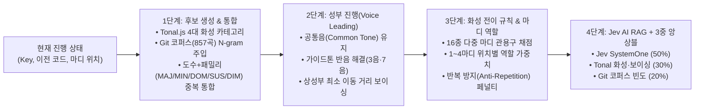

# Jev AI × Tonal.js × Neo-Soul RAG 코드 추천 근거 및 화성학 가이드

이 문서는 **Jev × Tonal 화성학 코드 진행 스튜디오**가 어떤 음악이론적 근거, 성부 진행(Voice Leading) 공식, 실전 네오소울 코퍼스(`inbm001/progressions`) 통계, 그리고 **Jev AI (`@typesafe-ai/sdk` System One)** 앙상블 가중치를 통해 다음 코드를 추천하는지 이론과 실제 예시로 정리한 기술·화성학 문서입니다.

---

## 1. 전체 추천 파이프라인 요약

엔진은 매 마디(Slot)마다 아래 **4단계 파이프라인**과 **3중 앙상블(Ensemble) 가중치 공식**을 거쳐 상위 15개의 후보 코드를 레이더(Radar) 위에 배치합니다.

### 최종 3중 앙상블 확률 공식
특정 모델이나 단일 규칙으로만 확률을 계산하면 매번 똑같은 코드 진행으로 수렴하거나, 반대로 음악적 개연성이 떨어지는 코드가 1위로 튀는 문제가 발생합니다. 이를 방지하기 위해 세 가지 독립된 확률 분포를 결합합니다:

$$P_{\text{Ensemble}}(c) = 0.50 \cdot P_{\text{Jev}}(c) + 0.30 \cdot P_{\text{Theory}}(c) + 0.20 \cdot P_{\text{Corpus}}(c)$$

| 구성 요소 | 비중 | 산출 근거 및 역할 |
| :--- | :---: | :--- |
| **$P_{\text{Jev}}(c)$** | **50%** | TypeSafe AI의 `jev-latest` (`systemOne`) 모델이 현재 장르 프리셋, 사용자 채팅/프롬프트 지시어, 그리고 각 후보의 `criteria` 명세를 대조해 산출한 문맥 적합도 확률 (온도 보정 $\tau = 0.82$ 적용) |
| **$P_{\text{Theory}}(c)$** | **30%** | `Tonal.js` 기반 화성 전이 규칙 점수(80%)와 성부 진행 매끄러움 점수(20%), 마디 위치별 역할 가중치, 반복 방지 페널티를 합산한 Softmax 확률 |
| **$P_{\text{Corpus}}(c)$** | **20%** | [`inbm001/progressions`](https://github.com/inbm001/progressions)의 실제 네오소울·R&B **857곡(11,022개 전이)**에서 직전 코드 뒤에 실제로 등장한 N-gram 빈도 확률 (Laplace 스무딩 적용) |

---

## 2. [1단계] 후보 생성의 이론적 근거 (`Tonal.js` × `Git 코퍼스`)

LLM이 조성을 벗어난 엉뚱한 화음을 환각(Hallucination)하지 못하도록, 1단계에서는 **화성학적으로 타당한 4대 카테고리 후보**와 **실제 네오소울 곡에서 검증된 상위 빈도 코드**만 후보군(Candidate Pool)으로 생성합니다.

### 2.1 4대 화성학 카테고리 (`Tonal.js` 생성)

| 카테고리 | 화성학적 원리 | C Major 기준 대표 예시 | 감정 레이더 방향 |
| :--- | :--- | :--- | :--- |
| **① 다이아토닉 (Diatonic)** | 해당 조성의 스케일 구성음만으로 만들어지는 7개의 기본 화음. **토닉(안식) - 서브도미넌트(확장) - 도미넌트(긴장)**의 골격을 형성합니다. | `Cmaj9`($\text{I}$), `Dm9`($\text{ii}$), `Em9`($\text{iii}$), `Fmaj9`($\text{IV}$), `G9sus4`($\text{V}$), `Am9`($\text{vi}$), `Bm7b5`($\text{vii}^\varnothing$) | • 토닉($\text{I, iii, vi}$): **9시(평온)** • 서브도미넌트($\text{ii, IV}$): **12시(설렘)** • 도미넌트($\text{V, vii}^\varnothing$): **3시(긴장)** |
| **② 세컨더리 도미넌트 (Secondary Dominant)** | 다이아토닉 화음(2도, 3도, 4도, 5도, 6도)을 일시적인 으뜸화음처럼 취급하여, 그 화음의 **완전5도 위에서 강하게 밀어주는 부속7화음($\text{V7/x}$)**입니다. 조표 밖의 임시 이륀음(Leading Tone)을 만들어 강렬한 추진력을 부여합니다. | • `A7#9#5` ($\text{V7/ii} \rightarrow \text{Dm9}$) • `B7#9#5` ($\text{V7/iii} \rightarrow \text{Em9}$) • `C7#9#5` ($\text{V7/IV} \rightarrow \text{Fmaj9}$) • `D7b9` ($\text{V7/V} \rightarrow \text{G13}$) • `E7#9#5` ($\text{V7/vi} \rightarrow \text{Am9}$) | **3시 방향** (긴장 · 추진력 · 에너지) |
| **③ 모달 인터체인지 (Modal Interchange)** | 같은 으뜸음을 공유하는 **패러렐 마이너(Parallel Minor, 예: C Minor)나 도리안/에올리안 모드에서 빌려온 차용화음**입니다. 밝은 장조 진행 속에 순간적인 애절함과 시네마틱한 색채 대비를 만듭니다. | • `Fm9` / `Fm6` ($\text{iv}$, 서브도미넌트 마이너) • `Bb9` ($\flat\text{VII9}$, 백도어 도미넌트) • `Abmaj9` ($\flat\text{VImaj9}$, 에올리안 6도) • `Ebmaj9` ($\flat\text{IIImaj9}$, 크로매틱 메디언트) | **6시 방향** (애절함 · 몽환 · 깊은 소울) |
| **④ 트라이톤 대리코드 (Tritone Substitution)** | 도미넌트 7th 코드의 핵심 불협화음인 **3음과 7음(트라이톤, 증4도/감5도)**을 그대로 공유하면서, **근음만 증4도(반음 6개) 바꾼 대리 도미넌트($\text{subV7}$)**입니다. 타깃 코드로 들어갈 때 베이스가 **반음 하행($\flat\text{II7} \rightarrow \text{I}$)**하며 재즈·네오소울 특유의 세련된 착지를 만듭니다. | • `Db9` ($\text{subV7/I}$: `G7` 대신 쓰여 `Db9 → Cmaj9` 반음 하행) • `Eb7` ($\text{subV7/ii}$: `A7` 대신 쓰여 `Eb7 → Dm9` 반음 하행) | **6시 방향** (몽환적 반음 하행 · 재즈 반전) |

---

### 2.2 장르별 텐션 자동 배합 (`★ 장르 자동` 모드)
실제 곡에서는 한 곡 안에서도 3화음, `add9`, `7th`, `9th`, `11th`, `13th`, `9sus4`, `m6`, `7#9#5`가 화성의 역할에 따라 섞여 쓰입니다. 따라서 3화음/7화음을 인위적으로 쪼개지 않고 장르 프리셋에 맞춰 최적의 텐션을 자동 부여합니다:

- **네오소울 / 재즈 R&B**: 토닉 `maj9`·`69`, 마이너 `m9`·`m11`, 도미넌트 `9sus4`·`13`, 부속화음 `7#9#5`·`7b9`, 대리코드 `9`·`7#11`
- **시티팝 / J-Pop 어반**: 토닉/서브도미넌트 `maj7`·`maj9`, 마이너 `m9`, 도미넌트 `9`·`13`·`9sus4`, 부속화음 `7b9`
- **감성 팝 / 발라드**: 토닉 `add9`·`maj7`, 도미넌트 `9sus4`·`7`, 서브도미넌트 마이너 `m6`
- **시네마틱 / 영화음악**: 개방감 있는 `add9`·`maj7`, 마이너 `m`·`m9`, 차용화음 `bVImaj7`·`bVII`

---

### 2.3 5대 화성 패밀리(`MAJ / MIN / DOM / SUS / DIM`) 분리 및 중복 통합
같은 근음의 텐션 변주 코드들(예: `Cmaj7`, `Cmaj9`, `Cmaj13`)이 동시에 후보에 올라오면 상위권 자리를 독식하고 확률을 쪼개먹는(Cannibalization) 현상이 생깁니다.
이를 막기 위해 모든 코드를 **`상대 도수(relPc 0~11) + 5대 화성 성질 패밀리`** 기준으로 그룹화하여 **패밀리당 가장 적합한 대표 코드 1개만 남기고 통합**합니다:

- `0:MAJ` 패밀리 (`Cmaj7`, `Cmaj9`, `Cmaj13`, `C69`) $\rightarrow$ **`Cmaj9`** 1개로 대표 통합 (코퍼스 등장 횟수 합산)
- `0:DOM` 패밀리 (`C7`, `C9`, `C7#9#5`) $\rightarrow$ **`C7#9#5`** ($\text{V7/IV}$ 기능으로 별도 유지!)
- `0:MIN` 패밀리 (`Cm7`, `Cm9`, `Cm11`) $\rightarrow$ **`Cm9`** (패러렐 마이너 토닉으로 별도 유지!)
- `0:SUS` 패밀리 (`C7sus4`, `C9sus4`) $\rightarrow$ **`C9sus4`** (서스펜디드 화음으로 별도 유지!)

덕분에 레이더 위에는 **서로 화성적 기능이 다른 개성 있는 후보들만 겹침 없이 배치**됩니다.

---

## 3. [2단계] 성부 진행(Voice Leading) 최적화 이론과 공식

좋은 코드 진행은 코드 기호뿐만 아니라 **건반 위에서 각 손가락(성부)이 얼마나 자연스럽게 연결되는가**로 결정됩니다. `buildSmoothVoicing` 함수는 직전 코드의 보이싱(`prevVoicing`)을 기준으로 다음 3가지 원칙에 따라 보이싱과 **성부 연결 점수(`smoothnessScore`, 35~99점)**를 계산합니다.

1. **공통음 유지 (Common Tone Retention, 개당 `+6점`)**:
   - 직전 코드와 겹치는 구성음(Pitch Class)이 있으면 같은 음역대에 머물게 합니다.
   - 예: `Cmaj9 (C-E-G-B-D)` $\rightarrow$ `Am9 (A-C-E-G-B)` 이동 시 **`C, E, G, B` 4개의 공통음**이 그대로 유지됩니다.
2. **가이드톤 반음 진행 (Half-Step Guide-Tone Resolution, 개당 `+7점`)**:
   - 상성부(오른손 보이싱)에서 **반음(1 Semitone) 차이로 부드럽게 미끄러지는 성부 이동**을 감지합니다.
   - 예: `Dm9`의 7음(`C`)이 `G13`의 3음(`B`)으로 **반음 하행(`C→B`)**하거나, `Fmaj7`(`A`)이 `Fm6`(`Ab`)으로 **반음 하행(`A→Ab`)**할 때 높은 점수를 받습니다.
3. **상성부 총 이동 거리 최소화 (Minimal Motion Penalty, 반음당 `-4.2점`)**:
   - 베이스(왼손, 2~3옥타브)를 제외한 오른손 4성부가 `F3 ~ F5` 음역대 안에서 직전 코드의 평균 높이와 가장 가까운 옥타브 자리를 자동으로 찾아 도약(Jump)을 최소화합니다.

$$\text{Smoothness Score} = \text{clamp}_{35}^{99}\Big(100 - 4.2 \times \Delta\text{Semitones} + 6 \times N_{\text{common}} + 7 \times N_{\text{halfstep}}\Big)$$

---

## 4. [3단계] 화성 전이(Transition) 규칙 및 마디 위치별 가중치

직전 1~2마디 코드와 후보 코드 사이의 화성학적 관계를 16가지 핵심 규칙으로 평가하며, 여기에 **Git 코퍼스 실제 출현 보너스(최대 `+14점`)**와 **마디 위치별 역할 가중치**를 더합니다.

### 4.1 주요 화성학 전이 규칙 및 실제 예시 (C Major 기준)

| 규칙 명칭 (`idiomTag`) | 화성학적 원리 및 조건 | C Major 실제 진행 예시 | 기본 가중치 |
| :--- | :--- | :--- | :---: |
| **투-파이브-원 완결 종지** (`ii-V-I Cadence`) | 2마디 전 $\text{ii}$ $\rightarrow$ 직전 $\text{V}$(또는 $\text{subV7}$) $\rightarrow$ 이번 마디 $\text{I}$로 이어지는 재즈·팝의 가장 완벽한 종지 구조 | `Dm9 → G9sus4 → Cmaj9` `Dm9 → Db9 → Cmaj9` | **96점** |
| **왕도 진행** (`왕도 진행`) | J-Pop·시티팝·케이팝의 대표 4마디 진행($\text{IV} \rightarrow \text{V} \rightarrow \text{iii} \rightarrow \text{vi}$). $\text{V}$ 뒤에 $\text{I}$ 대신 대리 토닉 $\text{iii}$로 빠져 아련한 감성을 만듦 | `Fmaj9 → G13 → Em9 → Am9` | **95~96점** |
| **세컨더리 5도 해결** (`Secondary Resolution`) | 직전 세컨더리 도미넌트($\text{V7/x}$)에서 근음이 완전5도 하행(완전4도 상행)하여 타깃 화음으로 정확히 해결되는 진행 | `A7#9#5 → Dm9` `E7#9#5 → Am9` | **95점** |
| **트라이톤 대리 반음 해결** (`Tritone Resolution`) | 직전 트라이톤 대리코드($\text{subV7}$)에서 베이스가 반음 하행($-1$)하여 타깃 코드로 미끄러지듯 착지하는 진행 | `Db9 → Cmaj9` `Eb7 → Dm9` | **95점** |
| **백도어 케이던스** (`Backdoor Cadence`) | 정규 $\text{V7}$ 대신 패러렐 마이너에서 빌려온 $\text{ivm7} \rightarrow \flat\text{VII9} \rightarrow \text{Imaj9}$로 장2도 상행 해결하는 네오소울·재즈 종지 | `Fm9 → Bb9 → Cmaj9` `Dm9 → Bb9 → Cmaj9` | **93~95점** |
| **Just The Two Of Us** (`Just The Two Of Us`) | $\text{IVmaj7}$에서 반음 아래의 세컨더리 도미넌트 $\text{III7}(\text{V7/vi})$을 거쳐 $\text{vim9}$으로 가는 그루브 진행 | `Fmaj9 → E7#9#5 → Am9` | **94점** |
| **서브도미넌트 마이너 클리셰** (`Modal Line Cliché`) | 메이저 $\text{IV}$ 바로 뒤에 마이너 $\text{ivm6/ivm9}$을 배치해 장3음(`A`)이 단3음(`Ab`)으로 반음 내려가는 감성 라인 클리셰 | `Fmaj9 → Fm6 (또는 Fm9) → Cmaj9` | **94점** |
| **정격종지** (`Authentic Cadence`) | 도미넌트($\text{V}$)에서 토닉($\text{I}$)으로 완전5도 하행 해결하여 강한 마침감을 주는 정통 종지 | `G9sus4 → Cmaj9` `G13 → Cmaj9` | **94점** |
| **반음 하행 대리 투파이브** (`Chromatic ii-subV-I`) | 서브도미넌트($\text{ii}$) 뒤에 $\text{V7}$ 대신 반음 아래의 $\text{subV7}$을 선택해 베이스가 `D → Db → C`로 반음씩 내려가는 진행 | `Dm9 → Db9 → Cmaj9` | **93점** |
| **5도권 순환 진행** (`Circle of 5ths`) | 근음이 완전4도 상행(완전5도 하행)하는 가장 자연스러운 화성 역학 이동 | `Em9 → Am9 → Dm9 → G13` | **89점** |
| **3도권 크로매틱 메디언트** (`Chromatic Mediant`) | 근음이 장/단3도 이동하면서 공통음을 유지한 채 조표 밖의 색채음을 도입하는 시네마틱·네오소울 전환 | `Cmaj9 → Ebmaj9` `Cmaj9 → Abmaj9` | **88점** |
| **온음 순차 그루브** (`Neo-Soul Stepwise`) | 네오소울·가스펠에서 자주 쓰이는 장2도(온음) 상·하행 패러렐 코드 이동 | `Cmaj9 → Dm9` `Fmaj9 → G9sus4` | **87점** |

---

### 4.2 마디 위치별(Phrase Position) 역할 가중치 & 반복 방지 페널티
4마디(또는 8마디) 프레이즈 안에서 현재 몇 번째 슬롯인지에 따라 가중치를 다르게 부여합니다:

1. **SLOT 1 (시작 코드 / Opening)**:
   - 안정적인 토닉($\text{I, vi}$)이나 네오소울/시티팝 스타일 오프닝($\text{IVmaj9, iim9}$)에 높은 점수를 부여합니다.
   - 첫 마디부터 해결 대상 없이 튀어나오는 얼터드 부속화음($\text{V7/x}$)이나 트라이톤 대리코드에는 **`-16점` 페널티**를 주어 어색한 시작을 방지합니다.
2. **SLOT 2 (전개 / Groove Expansion)**:
   - 화성 진행을 부드럽게 여는 서브도미넌트($\text{IV, ii}$)와 대리 토닉($\text{iii, vi}$)에 **`+6점` 가산점**을 부여하고, 너무 이른 강렬한 얼터드 코드(`#9#5`)는 소폭 억제합니다.
3. **SLOT 3 (고조 / Pre-Cadence Climax)**:
   - 프레이즈의 색채감과 긴장도를 최고조로 끌어올리는 마디이므로 **세컨더리 도미넌트, 모달 인터체인지, 트라이톤 대리코드에 `+6점` 가산점**을 부여합니다.
4. **SLOT 4 & SLOT 8 (종지 / Turnaround)**:
   - 3마디가 도미넌트($\text{V, subV7, bVII}$)였다면 **토닉($\text{I}$) 종지 후보에 `+8점`**을 부여합니다.
   - 3마디가 서브도미넌트나 토닉 대리였다면 다시 1마디로 돌아가는 **턴어라운드 도미넌트($\text{V9sus4, subV7, bVII9}$)에 `+8점`**을 부여합니다.
5. **반복 방지 (Anti-Repetition)**:
   - 최근 4마디 안에 이미 2번 이상 등장한 근음(`-16점`)이나 의미 없는 `A → B → A` 왕복 진행(`-12점`)에 페널티를 주어 매번 새로운 화성 흐름이 만들어지게 합니다.

---

## 5. [4단계] 실제 4마디 생성 예시로 보는 후보 & 선택 과정

아래는 **C Major · 네오소울 모드**에서 실제 엔진이 1마디부터 4마디까지 후보를 세우고 3중 앙상블 확률을 계산한 실제 로그입니다.

### ▶ SLOT 1 (시작 코드 선택)
| 순위 | 후보 코드 | 코퍼스 등장 | 화성학 규칙 및 근거 | 최종 앙상블 확률 (세부 비중) |
| :---: | :---: | :---: | :--- | :--- |
| **1위** | **`Cmaj9`** (`Imaj9`) | **119회** | 토닉(Tonic) 센터 오프닝 (*Sade “Maureen”, Pharrell “Have It All”*) | **52%** *(Jev 78% / 이론 12% / 코퍼스 44%)* |
| **2위** | **`Cm7`** (`im7`) | **22회** | 패러렐 마이너 토닉 오프닝 | **8%** *(Jev 2% / 이론 17% / 코퍼스 11%)* |
| **3위** | **`Fmaj9`** (`IVmaj9`) | **9회** | 서브도미넌트 오프닝 ($\text{IV}$ 시작 기법) | **8%** *(Jev 6% / 이론 12% / 코퍼스 5%)* |
| **4위** | **`Dm9`** (`ii9`) | **12회** | 투-파이브($\text{ii-V}$) 그루브 오프닝 | **7%** *(Jev 3% / 이론 12% / 코퍼스 7%)* |

> **선택 결과**: **`Cmaj9`** (또는 시티팝/네오소울 느낌을 원할 경우 3위 **`Fmaj9`** 선택 가능)

---

### ▶ SLOT 2 (`Cmaj9` 다음 코드)
| 순위 | 후보 코드 | 코퍼스 등장 | 화성학 규칙 및 근거 | 최종 앙상블 확률 (세부 비중) |
| :---: | :---: | :---: | :--- | :--- |
| **1위** | **`F9sus4`** (`IV9sus4`) | **24회** | 4도 서브도미넌트 서스 그루브 진행 | **44%** *(Jev 76% / 이론 11% / 코퍼스 14%)* |
| **2위** | **`Dm9`** (`ii9`) | **21회** | 온음 순차 그루브 진행 ($\text{Imaj9} \rightarrow \text{ii9}$) | **14%** *(Jev 16% / 이론 10% / 코퍼스 12%)* |
| **3위** | **`E7#9#5`** (`V7/vi`) | **12회** | 6도(`Am9`)를 향한 세컨더리 도미넌트 진입 | **6%** *(Jev 4% / 이론 9% / 코퍼스 7%)* |

> **선택 결과**: 2마디 서브도미넌트 진행을 위해 **`Dm9`** (또는 1위 **`F9sus4`**) 선택!

---

### ▶ SLOT 3 (`Cmaj9 → Dm9` 다음 코드)
| 순위 | 후보 코드 | 코퍼스 등장 | 화성학 규칙 및 근거 | 최종 앙상블 확률 (세부 비중) |
| :---: | :---: | :---: | :--- | :--- |
| **1위** | **`G9sus4`** (`V9sus4`) | **33회** | 5도권 투-파이브 ($\text{ii9} \rightarrow \text{V9sus4}$, 네오소울 서스 도미넌트) | **32%** *(Jev 52% / 이론 8% / 코퍼스 17%)* |
| **2위** | **`G9`** (`V9`) | **15회** | 정통 투-파이브 ($\text{ii9} \rightarrow \text{V9}$) | **12%** *(Jev 17% / 이론 8% / 코퍼스 9%)* |
| **3위** | **`Db9`** (`subV7/I`) | **4회** | 반음 하행 트라이톤 대리 투-파이브 (`Dm9 → Db9 → Cmaj9`) | **9%** *(Jev 11% / 이론 11% / 코퍼스 3%)* |
| **4위** | **`Gm9`** (`vm9`) | **22회** | 5도를 마이너로 바꾸는 모달 도미넌트 (*Kendrick Lamar*) | **9%** *(Jev 8% / 이론 8% / 코퍼스 12%)* |

> **선택 결과**: 네오소울 코퍼스에서 33회 검증된 1위 **`G9sus4`** (또는 재즈 반음 하행을 원하면 3위 **`Db9`**) 선택!

---

### ▶ SLOT 4 (`Cmaj9 → Dm9 → G9sus4` 다음 코드)
| 순위 | 후보 코드 | 코퍼스 등장 | 화성학 규칙 및 근거 | 최종 앙상블 확률 (세부 비중) |
| :---: | :---: | :---: | :--- | :--- |
| **1위** | **`Cmaj9`** (`Imaj9`) | **146회** | 투-파이브-원 ($\text{ii} \rightarrow \text{V} \rightarrow \text{I}$) 완결 종지 | **57%** *(Jev 85% / 이론 7% / 코퍼스 60%)* |
| **2위** | **`C9sus4`** (`I9sus4`) | **28회** | 서스펜디드 토닉 착지 (해결을 지연시키며 그루브 유지) | **8%** *(Jev 4% / 이론 10% / 코퍼스 15%)* |
| **3위** | **`Cm11`** (`im11`) | **16회** | 패러렐 마이너 토닉으로 어둡게 반전 착지 | **6%** *(Jev 0% / 이론 12% / 코퍼스 10%)* |
| **4위** | **`Ebmaj9`** (`bIIImaj9`) | **4회** | 3도권 크로매틱 메디언트 반전 종지 | **4%** *(Jev 2% / 이론 9% / 코퍼스 3%)* |

> **선택 결과**: 안정적인 해결을 원하면 1위 **`Cmaj9`**, 네오소울스러운 여운을 남기려면 2위 **`C9sus4`**, 극적인 반전을 원하면 3위 **`Cm11`**이나 4위 **`Ebmaj9`**을 레이더에서 골라 4마디를 완성합니다!

---

## 6. 레이더(Radar) UI의 4방위 감정 매핑 기준

화면 중앙의 레이더는 각 후보 코드의 **화성 기능(Function)**과 **색채(Category)**를 분석해 4개의 감정 방위로 배치합니다:

- **▲ 12시 방향 (`설렘 · 밝은 확장`)**: 다이아토닉 서브도미넌트($\text{IVmaj9, iim9, IV9sus4}$) — 화성적 공간을 넓히고 부유하는 느낌을 주는 진행
- **▶ 3시 방향 (`긴장 · 추진력`)**: 도미넌트 및 세컨더리 도미넌트($\text{V13, V9sus4, V7/vi, V7/ii}$) — 다음 타깃 코드로 강하게 밀어주는 에너지
- **▼ 6시 방향 (`애절함 · 몽환 · 반전`)**: 모달 인터체인지 및 트라이톤 대리코드($\text{ivm6, bVII9, bVImaj9, subV7}$) — 조표 밖의 음으로 애수나 재즈적 반전을 만드는 진행
- **◀ 9시 방향 (`평온 · 안식`)**: 토닉 및 대리 토닉($\text{Imaj9, vim9, iiim7}$) — 긴장을 해소하고 중심을 잡아주는 진행
